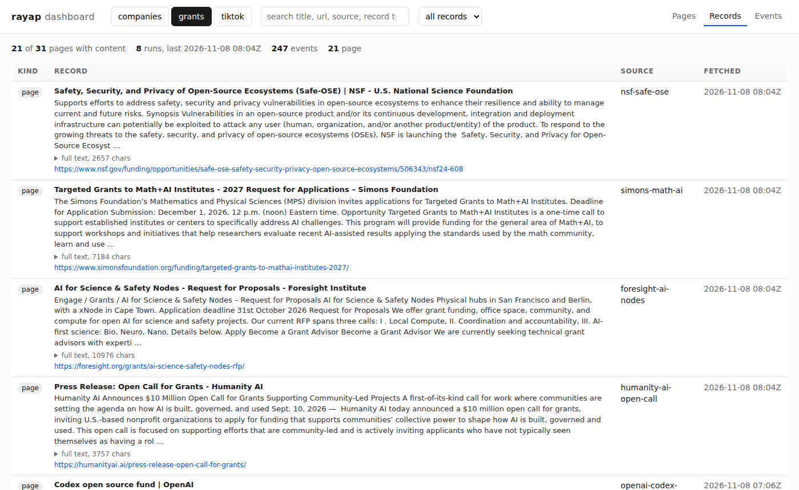

# rayap

A polite, restartable web crawl engine in Rust, with a politeness referee that proves it.

rayap crawls a list of sources and writes one JSON event per page (`new`, `changed`,
`unchanged`, `rebaseline`, `redirect`, `gone`, `blocked`, `error`) plus structured records
(page text, TikTok posts and comments, companies). State lives in SQLite: an interrupted
crawl resumes where it stopped, and the next run reports only what changed. One binary,
no services; a read-only dashboard and JSON API over the same file.

> Status: early. Built in one week (6–8 Nov 2026) as a portfolio piece for web-crawling
> infrastructure work. The engine and CLI are tested (141 tests); the numbers below are
> measured and every one links to its raw file and command.

## Measured

| Claim | Number | Where |
|---|---|---|
| Throughput, one process, 10,000 simulated hosts, 2 s per-host delay | **4,030 pages/s** steady, 1,730 over the whole crawl (6 Nov, median of 4) | [bench/README.md](bench/README.md#end-to-end-10000-hosts-4-runs-revision-2d0a321) |
| Politeness, same crawl, judged by an independent TCP-level referee | **0 proven violations**; the referee catches a crawler set 10 ms too fast 92,057 times | [negative control](bench/README.md#setup) |
| Batched commits (one transaction per drained batch) | **1.46x** steady throughput, 3 alternating pairs | [table](bench/README.md#a-second-optimisation-batched-commits-7-nov-2026) |
| Sharded coordinators (`--shards N`, one store writer) | **1.79x** at 8 shards on 10k hosts; the 20k-host cliff is gone (1.45x at 4 shards) | [table](bench/README.md#sharded-coordinators-8-nov-2026) |
| Revisit planner vs uniform polling, hidden change rates, oracle ceiling | **1.2–1.85x** changes caught per fetch; closes ~2/3 of the gap to the oracle; mean staleness 75 h → 28.5 h | [table](bench/README.md#revisit-scheduling-learned-change-rates-vs-uniform-polling-7-nov-2026) |
| Real sites: 118 TikTok posts, 3 revisits | 115 posts + 4,465 comments; **98 of 205 "changed" comment pages were the same comments reordered** (fixed: set fingerprint); TikTok's 44 KB captcha page refused by the validator and backed off from | [bench/tiktok](bench/tiktok/README.md), [revisit](bench/tiktok/revisit/README.md) |
| Real sites: 23 grant funders, 6 companies | 21 pages with readable text (two were JavaScript shells, reported as such); 5 `company` + 15 `company_page` records in 22 requests | [bench/grants](bench/grants/README.md), [examples/](examples/) |

100 million pages a day is 1,157 pages/s. The throughput numbers are a loopback
simulation, not the public internet; [bench/README.md](bench/README.md) lists what the
simulator does and does not model, and what breaks first now (the single store writer).



## How it behaves

- **One request at a time per host**, with a configurable delay between requests
  (default 2 s). `--shards N` splits hosts across N coordinators by host name; a host
  always belongs to exactly one, so the rule holds without locks. A slow or rate-limited host never holds up the others: hosts wait in a
  min-heap keyed by the time they may next be contacted.
- **robots.txt per RFC 9309**, with rayap's own parser: fetched before any page on an
  origin, cached at most 24 hours, first 500 KiB parsed. Groups for the `rayap` product token
  win over `*`; longest match wins, allow wins ties; `*` and `$` supported; percent-encoding
  is normalized, so `/%70rivate` is `/private`. A 4xx robots.txt allows everything; a 429,
  5xx or network failure keeps the origin's pages waiting and is retried with backoff, and
  only after `max_attempts` failures are the pages reported as blocked. Each robots.txt
  redirect hop (up to 5) is scheduled like any other request. Malformed or hostile rules
  never widen access. `Crawl-delay` is honoured per origin, capped by `max_crawl_delay_ms`.
- **Backs off when asked**: `429` and `503` hold the whole host for the full `Retry-After`
  (seconds or HTTP date); network errors and other 5xx retry with growing backoff, up to
  `max_attempts`. Every wait is stored, so a restart never contacts a host early. If the
  only remaining work is further away than `max_wait_ms` (default 10 minutes), the run ends
  unfinished and the next run resumes it.
- **Redirects are not followed blindly**: the target is queued as its own page, so it passes
  robots.txt and politeness checks for its own host. Chains stop after 10 hops, and links are
  only followed on the source's own host.
- **Identifies itself**: `Mozilla/5.0 (compatible; rayap/0.1.0; +<your contact>)`. A contact
  is required. With a `[signing]` section every request also carries Web Bot Auth headers
  (RFC 9421 HTTP Message Signatures, Ed25519, `tag="web-bot-auth"`, covering `@authority`
  and `Signature-Agent`), so a site can verify the request came from the holder of a key
  published at `https://<your-domain>/.well-known/http-message-signatures-directory` rather
  than trusting the User-Agent string. `rayap key new <file>` makes a key; `rayap key
  directory -c rayap.toml` prints the JWK Set to publish. The signer reproduces the IETF
  draft's test vector byte for byte (`signing.rs` tests).
- **Public pages only**: no logins, forms or CAPTCHAs.
- **Change detection ignores noise**: the fingerprint covers the page title and body text, not
  scripts, styles or markup, so a new tracking snippet is not a change.
- **At-least-once and resumable**: each outcome, its event and the links it found are
  committed in one SQLite transaction. If the process stops, the next start resumes the run and fetches only the
  pages that have no outcome yet.

## Use

```sh
cargo build --release
./target/release/rayap check -c examples/lampalampa-grants.toml
./target/release/rayap crawl -c examples/lampalampa-grants.toml --db grants.db
./target/release/rayap crawl -c examples/lampalampa-grants.toml --db grants.db --changes-only
./target/release/rayap events --db grants.db --after 120   # replay stored events
```

Config:

```toml
[crawler]
contact = "https://example.org/about-our-bot"   # required
per_host_delay_ms = 5000

[[source]]
name = "ngs-grants"
url = "https://www.nationalgeographic.org/explore/grants-investments"
max_depth = 0   # links to follow on the same host; 0 = this page only
```

An event:

```json
{"id":14,"run":2,"at":1793940000,"source":"ngs-grants","url":"https://...","kind":"changed",
 "status":200,"title":"Grants and Investments","hash":"…","prev_hash":"…","bytes":140213}
```

`id` only increases, so a consumer can store the last id it processed and read on from there.

### Dashboard

```sh
./target/release/rayap serve --db grants=grants.db --db tiktok=tiktok.db
# http://127.0.0.1:8732/
```

One read-only page over any number of crawl databases, each a *collection* (`grants`,
`tiktok`, anything you crawl next). Three views per collection, searchable: **Pages** (every
known page, its last outcome, when it was fetched, how often it changed), **Records** (what
was extracted: the visible text of each page, TikTok posts and comments; filter by kind,
search the text), **Events** (the change log). The same data as JSON:
`/api/collections`, `/api/{c}/pages?q=`, `/api/{c}/records?q=&kind=`, `/api/{c}/events?after=`.
The server only reads; `rayap crawl` can write to the same file meanwhile.

Every HTML page's main-content text is stored as a `page` record (up to 200 KB, marked
`truncated` beyond that), so a `changed` event can be read, not only noticed. Site chrome
(navigation, header, footer, asides, inline SVG) is left out, and a page that marks a
`main` or `article` region keeps only that; on the 21 grant pages this cut stored text by
19% and the records now start with the call, not the menu. A page with no readable text
at all (a JavaScript application shell) is an `error`, never fingerprinted; two of the real
example sources turned out to be such shells. An `unchanged` page writes no records.

### Watching grant pages

`examples/ai-oss-grants.toml` lists 23 public pages of funders that give grants to AI and
open-source projects (Sovereign Tech, NLnet, OTF, GitHub Secure Open Source Fund, Mozilla,
Humanity AI, Cooperative AI, NSF Safe-OSE, and others), 5 s between requests. Two crawls
on 7 Nov 2026, about 3 MB and 3 minutes each:

| | Run 1 | Run 2, `--changes-only` |
|---|---|---|
| Pages with content | 20 `new` | 20 `unchanged`, 1 `new` (a corrected URL) |
| Redirects followed | 6 (moved URLs at FUTO, GitHub, NSF, WASP-HS) | 7 |
| Not available | prototypefund.de `error` HTTP 403 (a WAF rule: curl with a browser UA gets 403 too); mozillafoundation.org `blocked` (its robots.txt never answers from this network, so rayap does not fetch the page); one 404 from a wrong URL guess | same |

The second run printed one line. From here on, `--changes-only` shows only pages whose
visible text changed: a new call, a moved deadline, a closed programme.

**LinkedIn is not a source.** Its robots.txt is `User-agent: * Disallow: /` with a notice
that automated access needs written permission (`whitelist-crawl@linkedin.com`); search and
feed URLs redirect to login, company post pages return 403. rayap's robots.txt gate blocks
every LinkedIn URL before any page request, which is the correct behaviour. The routes that
exist are their crawl whitelist, the official APIs for a page you own, or a page you control
where people post the links.

### JavaScript pages

`render = true` on a source fetches its pages with a headless Chromium or Chrome found on
`PATH` (or `RAYAP_BROWSER`), lets the page's scripts run for a bounded virtual time, and
digests the resulting DOM with the same extractor and validator as an HTTP body. The
request still waits its turn in the host's queue, passes robots.txt, and carries rayap's
user agent. newsfuel.org's opportunity pages, a 55-character shell over HTTP, come back as
900 characters of text with the deadline in them.

What it does not do: solve captchas, spoof fingerprints, rotate identities or reuse
logins. A challenge page rendered in a browser is still a challenge page. And a site whose
main region is empty even in a browser (alpha-omega.dev/grants on 8 Nov 2026) is still an
`error`. The browser's own subresource requests are not scheduled by rayap, so this route
is for the handful of sources that need it, not for broad crawls. Without a browser
installed, rendered sources report an error instead of silently falling back to HTTP.

### Structured sources: companies

`kind = "company"` reads an organisation's public website: the homepage becomes one
`company` record (name, legal name and logo from JSON-LD `Organization` when present,
description from meta tags, type, the well-known pages it links, its official social
profiles, and its main text), and each well-known page it links (about, careers, contact,
blog/news, products) becomes a `company_page` record with that page's text. Revisits
report which of those changed: a new role on the careers page, a new post, a changed
description. `examples/companies.toml` has six; on 8 Nov 2026 it produced 5 `company`
and 15 `company_page` records in 22 requests (one blocked: mozillafoundation.org's
robots.txt does not answer from this network).

Organisation-level, public facts only. The extractor does not look for people, personal
email addresses or phone numbers, and it records social profile URLs without visiting them.

### Structured sources: TikTok posts

A source with `kind = "tiktok"` reads a public post and its comments into records instead
of a text fingerprint. The post page embeds its data as JSON; comments come from the
paginated comment endpoint on the same host. Every request still goes through the host
queue, robots.txt and the stored holds. A `200` is not trusted blindly: a page without the
embedded data (challenge screen, empty application shell) is an `error`, a deleted or
under-review post is `gone`, and neither is recorded as content.

```toml
[[source]]
name = "frogs"
url = "https://www.tiktok.com/@tiktok/video/7106594312292453675"
kind = "tiktok"
max_comments = 60   # top-level comments to collect, in pages of 20
```

```sh
./target/release/rayap crawl -c sources.toml --db tiktok.db
./target/release/rayap records --db tiktok.db --kind post
./target/release/rayap records --db tiktok.db --kind comment --after 0
```

A `post` record carries `author`, `text`, `hashtags`, `mentions`, `music`, `duration_s`,
`created_at` and `stats` (plays, likes, comments, shares, saves); a `comment` record carries
`post_id`, `comment_id`, `author`, `text`, `likes`, `replies`, `created_at`. The change
fingerprint covers ids and text only (comment pages as a set, since TikTok reorders them),
so a like count moving or a reorder is not a change. Records are keyed by `(kind, key)` and
replaced when fetched again.

**Revisits.** `rayap crawl --budget N` visits every page never fetched plus the N known
pages most due by their learned change rate (`rayap rates` shows the rates). Comment pages
are continuation pages: they are fetched again only when their post is new or changed, or
when the post's comment count moved. So an unchanged post costs one request per revisit.
A verification page served instead of a post (HTTP 200, no data) holds the host for five
minutes and the page is retried; nothing is stored.

Measured 7 Nov 2026: 118 public posts, 2 s between requests, no login or cookies. First
visit and revisits in [bench/tiktok](bench/tiktok/README.md) and
[bench/tiktok/revisit](bench/tiktok/revisit/README.md): a visit-everything revisit costs
368 requests and 67 MB, 77% of it post pages; a `--budget 30` revisit 30 requests and 13 MB.
New comments found per byte is not measured yet (no comments arrived in the windows tried).
TikTok's robots.txt allows `/@handle/video/` for rayap's user agent; its terms of service
forbid automated collection, so keep volume low and use it only where you have the right to.

## Layout

| Path | What |
|---|---|
| `crates/rayap-core/src/frontier.rs` | per-host queues and the earliest-eligible-host heap |
| `crates/rayap-core/src/crawler.rs` | the crawl loop: sharded coordinators, robots.txt gate, retries, holds |
| `crates/rayap-core/src/writer.rs` | the one task that writes the store; shards send it batches |
| `crates/rayap-core/src/robots.rs` | RFC 9309 parser and matcher |
| `crates/rayap-core/src/store.rs` | SQLite state: runs, pages, events, records, revisits, holds; planned runs |
| `crates/rayap-core/src/revisit.rs` | change-rate estimation and budget allocation (Cho & Garcia-Molina) |
| `crates/rayap-core/src/fetch.rs` | HTTP and browser routes, extractors, the 2xx validator |
| `crates/rayap-core/src/html.rs` | streaming main-content extraction with `lol_html` |
| `crates/rayap-core/src/tiktok.rs`, `company.rs` | structured sources: records from posts/comments and company sites |
| `crates/rayap-core/src/render.rs` | headless Chrome route for JavaScript pages |
| `crates/rayap-core/src/signing.rs` | Web Bot Auth request signing (RFC 9421, Ed25519) |
| `crates/rayap-core/tests/crawl.rs` | 29 end-to-end tests against a local server, run at 1 and N shards |
| `crates/rayap-cli` | the `rayap` command: `crawl`, `events`, `records`, `rates`, `serve`, `key`, `check` |
| `crates/rayap-serve` | read-only JSON API and the one-file dashboard |
| `crates/rayap-sim` | simulated web plus the independent politeness referee |
| `crates/rayap-bench` | end-to-end, scheduler-only and revisit benchmarks, with flamegraphs |
| `bench/` | every measurement, its command and its raw JSON |
| `examples/` | grant funders, companies, and the Lampalampa sources |

## Roadmap

1. Measure new comments per KB: planned vs visit-everything revisits a day apart on posts
   that still receive comments (the planner and the activity-gated comment pages are in;
   the windows tried so far had no new comments in either arm).
2. Cheaper writes and, when needed, one database per shard: with `--shards` in, the single
   store writer is what caps throughput (see "What breaks first" in the benchmark).
3. Conditional requests (`If-None-Match`, `If-Modified-Since`). Deferred: of the 7 real
   sources in `examples/` and `bench/tiktok`, checked 7 Nov 2026, only one
   (andpurpose.world) sends a validator and answers 304; the rest send neither `ETag` nor
   `Last-Modified`, so conditional requests would save nothing there.
4. Signed-directory response (the optional signature over the JWK Set itself, for
   redistributed keys) and `Accept-Signature` negotiation; request signing is in.

## License

Licensed under either of [Apache License, Version 2.0](LICENSE-APACHE) or
[MIT license](LICENSE-MIT) at your option.
