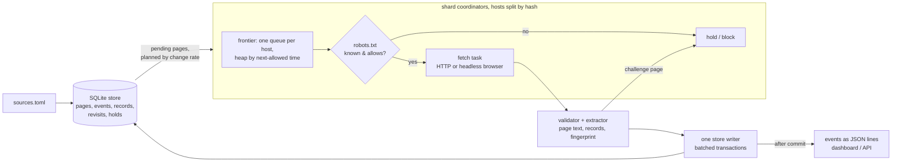

# rayap

A polite, restartable web crawl engine in Rust, with a politeness referee that proves it.

Most crawlers measure their own politeness, so the claim "we wait N seconds between
requests" cannot be checked from outside. rayap ships a simulator that serves 10,000 hosts
and judges every request itself, at the TCP level, from the server's side. Against that
referee rayap makes **0 proven violations** at 4,030 pages/s, and a crawler set only 10 ms
too fast is caught 92,057 times in the same crawl. The rest of the engine follows the same
rule: every number below is measured and links to the file and command that produced it.

What it does: crawl a list of sources, one request at a time per host with robots.txt
checked first, keep all state in SQLite so a crash resumes instead of restarting, and write
one JSON event per page (`new`, `changed`, `unchanged`, `rebaseline`, `redirect`, `gone`,
`blocked`, `error`) with the page's main text stored so a change can be read, not only
noticed. Public pages only: no logins, no CAPTCHA solving, no fingerprint spoofing, and a
site that blocks the crawler stays blocked.

> Status: early. One developer, built 6–8 Nov 2026. 151 tests; the end-to-end suite runs
> at 1 and N shards. [docs/write-up.md](docs/write-up.md) tells the three findings behind
> the numbers in 1,400 words and is the best place to start reading.

## Measured

All on one laptop (i7-12650H, WSL2) against a loopback simulator, not the public internet.
Full tables, every raw file and its command: [bench/README.md](bench/README.md).

- **4,030 pages/s** steady and 1,730 over the whole crawl, one process, 10,000 hosts, 2 s
  per-host delay, every outcome committed to SQLite (median of 4 runs,
  [table](bench/README.md#end-to-end-10000-hosts-4-runs-revision-2d0a321)). 100 million
  pages a day is 1,157/s; this is a simulation and says nothing about public-web capacity.
- **0 proven politeness violations** in those runs. The referee judges a response's end
  from the client's TCP acknowledgement and counts only what it can prove; the negative
  control at 1,990 ms against a 2,000 ms rule yields 92,057 catches
  ([setup and controls](bench/README.md#setup)).
- **1.46x** steady throughput from committing one transaction per drained batch instead of
  per page, 3 alternating before/after pairs
  ([table](bench/README.md#a-second-optimisation-batched-commits-7-nov-2026)).
- **1.79x** at 8 shards on 10,000 hosts from splitting hosts across coordinators with one
  store writer; the cliff at 20,000 hosts is gone (1.45x at 4 shards). Sub-linear, and the
  profile says why: the writer is what breaks first now
  ([table](bench/README.md#sharded-coordinators-8-nov-2026),
  [what breaks first](bench/README.md#what-breaks-first)).
- **1.2–1.85x** changes caught per fetch from the revisit planner against uniform polling
  on 20,000 pages with hidden change rates, closing about two thirds of the gap to an
  oracle that knows the true rates; mean staleness 75 h → 28.5 h. Not an order of
  magnitude, and the write-up says why
  ([table](bench/README.md#revisit-scheduling-learned-change-rates-vs-uniform-polling-7-nov-2026)).
- **Real sites changed the engine.** On 118 public TikTok posts revisited three times, 98 of
  205 "changed" comment pages were the same comments reordered (fix: set fingerprints), and
  a 44 KB CAPTCHA page served with HTTP 200 was refused by the validator and treated as a
  back-off signal (aggregates only, raw captures are not published:
  [bench/tiktok](bench/tiktok/README.md)). Of 23 grant funders' pages, two were JavaScript
  shells and are reported as such, not fingerprinted ([bench/grants](bench/grants/README.md)).

## How it works



- **One request in flight per host**, with a delay between requests (default 2 s). Hosts
  wait in a min-heap keyed by the time they may next be contacted, so a slow or
  rate-limited host never holds up the others. `--shards N` splits hosts across N
  coordinators by host name; a host belongs to exactly one, so the rule holds without locks.
- **robots.txt per RFC 9309**, own parser: fetched before any page on an origin, cached at
  most 24 h, first 500 KiB parsed. `rayap` groups win over `*`; longest match wins, allow
  wins ties; `*` and `$`; percent-encoding normalised. A 4xx allows everything; a 429, 5xx
  or network failure keeps the origin's pages waiting with backoff, and only after
  `max_attempts` failures are they reported `blocked`. Redirect hops (up to 5) are scheduled
  like any other request. `Crawl-delay` is honoured per origin, capped by `max_crawl_delay_ms`.
- **Backs off when asked.** `429` and `503` hold the whole host for the full `Retry-After`;
  other failures retry with growing backoff up to `max_attempts`. Every wait is stored, so a
  restart never contacts a host early. A verification page served with HTTP 200 (empty
  title, bot-check script, no data) is a challenge: the host is held five minutes and the
  page retried; nothing is stored.
- **A 200 is not content until the validator says so.** An empty application shell, a
  deleted post reported inside the JSON, a challenge page: each is `error`, `gone` or a
  back-off, never a fingerprint. Fingerprints carry a method version; a code change that
  alters a fingerprint reports `rebaseline`, never `changed`.
- **Redirects are not followed blindly**: the target is queued as its own page and passes
  robots.txt and politeness for its own host. Chains stop after 10 hops; links are followed
  only on the source's host.
- **Identifies itself**: `Mozilla/5.0 (compatible; rayap/0.1.0; +<your contact>)`, contact
  required. With `[signing]`, every request also carries Web Bot Auth headers (RFC 9421,
  Ed25519, `tag="web-bot-auth"`) that a site can verify against the key published at
  `/.well-known/http-message-signatures-directory`; the signer reproduces the IETF draft's
  test vector byte for byte (`signing.rs`).
- **At-least-once and resumable**: an outcome, its event, its records and the pages it led
  to are committed together; shards hand cross-host pages to each other only after the
  commit. If the process stops, the next start fetches only the pages with no outcome.
- **Revisits learn.** `rayap crawl --budget N` visits the N known pages most due by their
  learned change rate (Cho & Garcia-Molina, posterior-mode rate from "changed since last
  visit" observations), plus every page never fetched. Continuation pages (the next page of
  a list) are fetched only when their parent changed or its activity count moved.
- **JavaScript pages** can be fetched through a headless Chromium (`render = true`), through
  the same queue, robots check and validator; no sessions, no evasion.

## Quickstart

```sh
git clone https://github.com/daefery/rayap && cd rayap
cargo build --release
./target/release/rayap check -c examples/ai-oss-grants.toml
./target/release/rayap crawl -c examples/ai-oss-grants.toml --db grants.db
./target/release/rayap crawl -c examples/ai-oss-grants.toml --db grants.db --changes-only
./target/release/rayap serve --db grants=grants.db     # http://127.0.0.1:8732/
```

`check` prints the source count and the exact User-Agent. The first crawl of the 23 grant
pages takes about three minutes at 5 s per host and prints one line per outcome:

```json
{"id":9,"run":1,"at":1794053838,"source":"nlnet-open-calls","url":"https://nlnet.nl/propose/","kind":"new","status":200,"title":"NLnet; Apply for a grant","hash":"5b3b9c88…","bytes":44500}
{"id":12,"run":1,"at":1794053838,"source":"prototype-fund","url":"https://prototypefund.de/en/apply/","kind":"redirect","status":301,"detail":"https://www.prototypefund.de/en/apply/"}
{"id":22,"run":1,"at":1794053843,"source":"prototype-fund","url":"https://www.prototypefund.de/en/apply/","kind":"error","status":403,"detail":"HTTP 403"}
```

(Lines from the 7 Nov 2026 run, hash shortened; today's build prefixes hashes with the
fingerprint version, `v3:…`, and adds `"records":1` for pages whose text was stored.)

The second crawl with `--changes-only` prints nothing unless a page's main text changed.
`id` only increases, so a consumer stores the last id it handled and reads on with
`rayap events --after N`.

Minimal config:

```toml
[crawler]
contact = "https://example.org/about-our-bot"   # required; goes into the User-Agent
per_host_delay_ms = 5000

[[source]]
name = "ngs-grants"
url = "https://www.nationalgeographic.org/explore/grants-investments"
max_depth = 0   # links to follow on the same host; 0 = this page only
```

Beyond plain pages: `kind = "company"` (an organisation's site, its well-known pages and
its own job board), `kind = "ats"` / `"jobs"` (employer boards through Greenhouse, Lever
and Ashby APIs; aggregator feeds), `kind = "tiktok"`, `render = true`, and the read-only
dashboard with its JSON API are described in [docs/sources.md](docs/sources.md).


## What breaks first

Named with numbers in [bench/README.md](bench/README.md#what-breaks-first): the single
store writer (8 shards use 1.76 cores and wait on it), memory per queued URL (0.9 GiB at
10,000 hosts, 4.5 GiB at 40,000), one SQLite file. The next steps, in order: cheaper
writes, acknowledge a batch before fsync, one database per shard.

## Layout

| Path | What |
|---|---|
| `crates/rayap-core/src/frontier.rs` | per-host queues and the earliest-eligible-host heap |
| `crates/rayap-core/src/crawler.rs` | the crawl loop: sharded coordinators, robots.txt gate, retries, holds |
| `crates/rayap-core/src/writer.rs` | the one task that writes the store; shards send it batches |
| `crates/rayap-core/src/robots.rs` | RFC 9309 parser and matcher |
| `crates/rayap-core/src/store.rs` | SQLite state: runs, pages, events, records, revisits, holds; planned runs |
| `crates/rayap-core/src/revisit.rs` | change-rate estimation and budget allocation |
| `crates/rayap-core/src/fetch.rs` | HTTP and browser routes, extractors, the 2xx validator |
| `crates/rayap-core/src/html.rs` | streaming main-content extraction with `lol_html` |
| `crates/rayap-core/src/tiktok.rs`, `company.rs`, `jobs.rs`, `ats.rs` | structured sources |
| `crates/rayap-core/src/render.rs` | headless Chrome route for JavaScript pages |
| `crates/rayap-core/src/signing.rs` | Web Bot Auth request signing (RFC 9421, Ed25519) |
| `crates/rayap-core/tests/crawl.rs` | 30 end-to-end tests against a local server, run at 1 and N shards |
| `crates/rayap-cli` | the `rayap` command: `crawl`, `events`, `records`, `rates`, `serve`, `key`, `check` |
| `crates/rayap-serve` | read-only JSON API and the one-file dashboard |
| `crates/rayap-sim` | simulated web plus the independent politeness referee |
| `crates/rayap-bench` | end-to-end, scheduler-only and revisit benchmarks, with flamegraphs |
| `bench/` | every measurement, its command and its raw JSON |
| `docs/` | [write-up](docs/write-up.md), [sources and dashboard](docs/sources.md) |
| `examples/` | grant funders, companies, job boards |

## Roadmap

1. Measure new comments per KB: planned vs visit-everything revisits a day apart on posts
   that still receive comments (the planner and the activity-gated comment pages are in;
   the windows tried so far had no new comments in either arm).
2. Cheaper writes and, when needed, one database per shard: with `--shards` in, the single
   store writer is what caps throughput (see "What breaks first" in the benchmark).
3. Conditional requests (`If-None-Match`, `If-Modified-Since`). Deferred: of the 7 real
   sources in `examples/`, checked 7 Nov 2026, only one
   (andpurpose.world) sends a validator and answers 304; the rest send neither `ETag` nor
   `Last-Modified`, so conditional requests would save nothing there.
4. Signed-directory response (the optional signature over the JWK Set itself, for
   redistributed keys) and `Accept-Signature` negotiation; request signing is in.

## License

Licensed under either of [Apache License, Version 2.0](LICENSE-APACHE) or
[MIT license](LICENSE-MIT) at your option.
