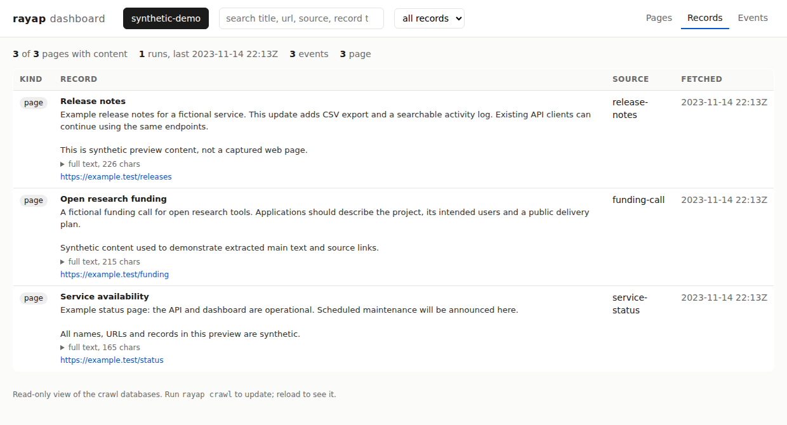
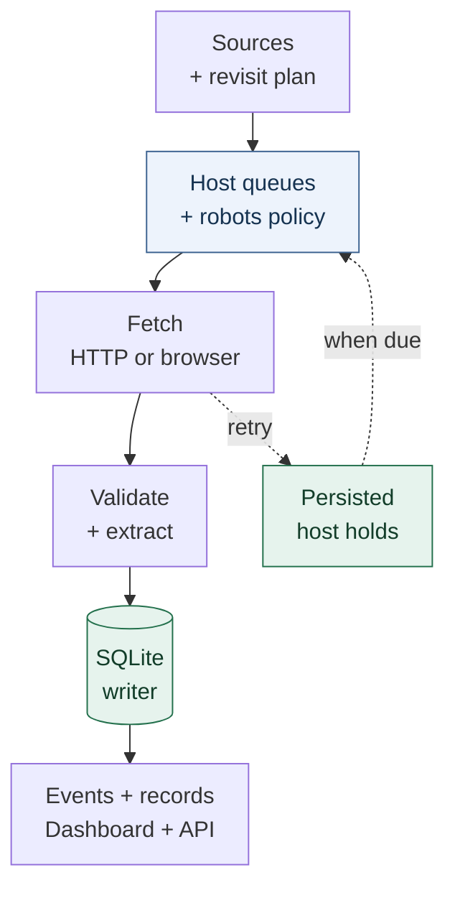

# rayap

[](https://github.com/daefery/rayap/actions/workflows/ci.yml) [](rust-toolchain.toml)

**A restartable web crawler in Rust, with a local dashboard and a server-side politeness referee.**

Give Rayap a list of sources. It schedules requests by host, stores crawl state in SQLite,
and reports content changes as JSON events. Open the dashboard to read the extracted text
and inspect what succeeded, changed or failed.

[Quickstart](#quickstart) · [Architecture](#architecture) · [Measurements](#measurements) · [Source guides](#sources-and-records) · [Engineering write-up](docs/write-up.md)

> **Early-stage, single-machine engine.** Robots rules are respected by default, with
> [explicit per-origin exceptions](docs/sources.md#explicit-robots-overrides).
> No login automation, CAPTCHA solving or fingerprint spoofing.



*Dashboard preview with synthetic records. No crawled content is shown.*

## What you get

| Capability | What it does |
|---|---|
| **Host-aware scheduling** | Per-host queues, delays, robots checks and persisted retry holds |
| **Restart recovery** | Resume unfinished work from the SQLite database |
| **Change tracking** | Content fingerprints, versioned rebaselines and budgeted revisits |
| **Inspectable output** | JSON events, extracted records, search and a local dashboard |

The included simulator checks politeness from the **server's side**. A deliberately too-fast
crawler is the negative control. Read [the experiment and its limits](docs/write-up.md)
for the reasoning behind the engine.

## Measurements

**Loopback simulations, not public-web capacity.** Recorded on an i7-12650H laptop under
WSL2, 6 to 8 November 2026. These are separate experiments, not multipliers to combine.

| Experiment | Recorded result | Evidence |
|---|---|---|
| HTTP crawl, 10,000 hosts, 2 s delay | **~4,030 pages/s** steady, **~1,730** whole run | [Four-run table](bench/README.md#end-to-end-10000-hosts-4-runs-revision-2d0a321) |
| Server-side politeness checks | **0 proven violations**, **92,057 catches** with the too-fast control | [Referee and control](bench/README.md#setup) |
| Batched commits | **1.46x** steady throughput | [Three alternating pairs](bench/README.md#a-second-optimisation-batched-commits-7-nov-2026) |
| Host-sharded coordinators | **1.79x** at 8 shards on 10,000 hosts | [Shard comparison](bench/README.md#sharded-coordinators-8-nov-2026) |
| Learned revisit scheduling | **1.2 to 1.85x** changes caught per fetch | [Planner versus uniform polling](bench/README.md#revisit-scheduling-learned-change-rates-vs-uniform-polling-7-nov-2026) |

The referee reports uncertain timings separately from proven violations. Later builds also
store page text, so the older throughput figure is not a benchmark of today's build.
[Raw results, commands and caveats](bench/README.md)

Real sites also shaped the engine: **98 of 205** changed comment pages contained the same
comments reordered. That led to set fingerprints.
[Aggregate findings](docs/engine.md#findings-from-real-sites)

## Quickstart

### 1. Build

Use [rustup](https://rustup.rs/) with the [pinned toolchain](rust-toolchain.toml).

```sh
git clone https://github.com/daefery/rayap.git
cd rayap
cargo build --release -p rayap-cli
```

### 2. Check a configuration

This validates the bundled grant-page example without crawling it:

```sh
./target/release/rayap check -c examples/ai-oss-grants.toml
```

```text
ok: 23 source(s)
user-agent: Mozilla/5.0 (compatible; rayap/0.1.0; +https://github.com/daefery/rayap)
```

For your own sources, set `crawler.contact` to your contact URL or email.
[Configuration and source guides](docs/sources.md)

### 3. Crawl, then open the dashboard

Keep the database outside the checkout:

```sh
mkdir -p "$HOME/rayap"
./target/release/rayap crawl -c examples/ai-oss-grants.toml --db "$HOME/rayap/grants.db"
./target/release/rayap serve --db "grants=$HOME/rayap/grants.db"
```

Open **[localhost:8732](http://127.0.0.1:8732/)**. Use **Pages** for crawl outcomes,
**Records** for extracted content and **Events** for the change log.

<details>
<summary><strong>Revisit pages and consume changes</strong></summary>

Run the same crawl against the same database to revisit pages. Add `--changes-only`
to print only `new` and `changed` events:

```sh
./target/release/rayap crawl -c examples/ai-oss-grants.toml --db "$HOME/rayap/grants.db" --changes-only
./target/release/rayap events --db "$HOME/rayap/grants.db" --after 0
```

Store the last event id your consumer handled, then use it with `--after`.
Errors and blocked pages are excluded by `--changes-only`, but remain in the event log.
[Event types and an illustrative payload](docs/engine.md#event-output)

</details>

<details>
<summary><strong>Minimal configuration for your own page</strong></summary>

```toml
[crawler]
contact = "https://example.org/about-our-bot"
per_host_delay_ms = 5000

[[source]]
name = "example"
url = "https://example.org/"
max_depth = 0
```

Replace both URLs before use. `max_depth = 0` fetches the configured page without
following ordinary links. A larger value follows links on the same host.

</details>

## Architecture



Each host belongs to one coordinator. Outcomes and discovered pages are committed before
events are delivered. Browser redirects and subrequests sit outside the per-request
scheduler. See [browser limits](docs/sources.md#javascript-pages).

[Detailed engine behavior and code map](docs/engine.md)

## Sources and records

| Read or inspect | Guide |
|---|---|
| HTML pages and grant watching | [Page sources](docs/sources.md#watching-grant-pages) |
| JavaScript-rendered pages | [Browser route and limits](docs/sources.md#javascript-pages) |
| Company sites and employer job boards | [Companies](docs/sources.md#structured-sources-companies) and [ATS feeds](docs/sources.md#employer-job-boards-greenhouse-lever-ashby) |
| Public TikTok posts | [Post and comment records](docs/sources.md#structured-sources-tiktok-posts) |
| Imported Instagram snapshots | [Dashboard records](docs/instagram-dashboard.md), not yet a built-in crawler source |

## Limits and next work

- **One store writer and one SQLite file.** Writes constrain shard scaling.
  [Measured bottlenecks](bench/README.md#what-breaks-first)
- **Memory grows with queued URLs.** A disk-backed frontier is future work.
- **Browser and extraction limits matter.** A readable page is not proof of complete
  comments or engagement data. Imported snapshots label missing counts and partial coverage.
- **Public-web scale remains unmeasured.** Loopback throughput does not establish internet
  throughput. Keep crawl databases and captures local, outside Git.

[Proposed next work](docs/engine.md#next-work) · [Source code map](docs/engine.md#code-map) · [Reproduce the benchmarks](bench/README.md#reproduce)

## License

Choose [Apache License 2.0](LICENSE-APACHE) or [MIT](LICENSE-MIT).
